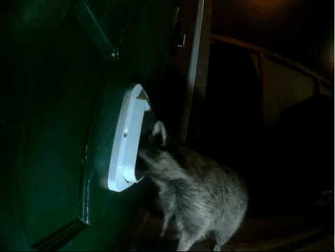
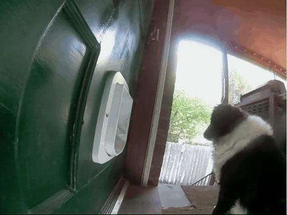
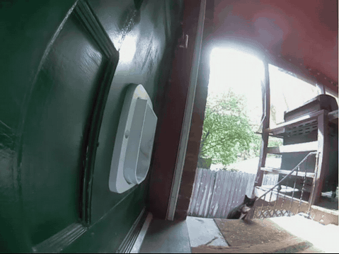
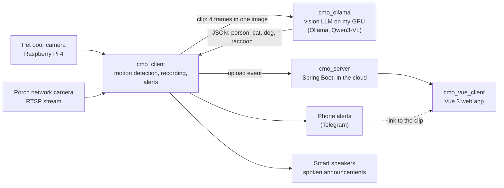
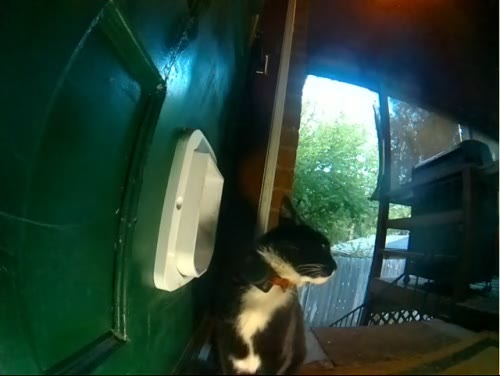

# Private AI home camera system

**Home cameras that record motion, have a vision AI running on my own computer decide what's in each clip, and
tell the household: phone alerts, spoken announcements on smart speakers, and a web app for browsing every
event.**

Is it a person, a cat, a dog or a raccoon? A vision language model answers in a few seconds, on my own GPU, so no
footage is sent to an AI company. I built the whole system end to end: the camera software, the AI step and how
it's tested, the server, the web app, and the cloud deployment.

<table>
  <tr>
    <td></td>
    <td></td>
    <td></td>
  </tr>
  <tr>
    <td><b>2:14 am.</b> AI: <code>raccoon</code>. Everyone's phone gets a raccoon alert.</td>
    <td><b>9:58 am.</b> AI: <code>dog</code>. Just saying hello.</td>
    <td><b>12:53 pm.</b> AI: <code>cat</code>. The speakers say the cat is at the pet door.</td>
  </tr>
</table>

## At a glance

| | |
| --- | --- |
| **Cameras** | Two: a Raspberry Pi 4 camera at the pet door, and an off-the-shelf network camera on the porch (RTSP) |
| **AI** | A vision language model (Qwen3-VL 8B) on [Ollama](https://ollama.com), on one consumer GPU at home |
| **Volume** | About 900 AI checks a day across both cameras |
| **Speed** | A few seconds per check; a cat at the pet door is announced while it's still there |
| **Accuracy** | Tested on 139 hand-labeled clips. Pet door: 95 of 118 clips with every label right. Porch: from 11 to 19 of 21 after I added motion cropping |
| **Cost** | Free on my own GPU, apart from electricity. The same volume on paid AI services: about $2-7 a month on the cheapest vision models, about $70 on a mid-size model, about $140 on a large one ([the estimate](https://github.com/markmckellar/cmo_ollama/blob/main/likely_costs_for_outside_LLM.md)) |

## What it shows

- **Private AI.** Classification runs on a machine I control. The same approach suits data that can't leave the
  building, such as health or lab data.
- **Measuring AI instead of trusting it.** A labeled test set, a scoring script, and a rule: no model or setting
  changes without a score that says it's better. (Checking 117 clips by eye found the earlier model wrong on 47 of
  them; it called the cat below a dog.)
- **Decisions made with numbers.** Local vs. paid models, which model, how many frames, crop or not: each was
  measured for accuracy, speed, tokens and cost.
- **Full stack, end to end.** Python on the Raspberry Pi, Bash, Java and Spring Boot, Vue 3 and TypeScript,
  Linux, cloud hosting on my own domain with HTTPS.
- **Running it for real.** It runs every day. Cameras drop off and come back, the AI server can be
  busy or down, and alerts must not repeat; each of those is handled, logged and versioned.

## How it works

1. **Watch.** One ffmpeg process per camera copies the camera's own video into short segments (almost no CPU,
   even on a Raspberry Pi) and decodes a few small frames a second for a motion check.
2. **Cut.** Motion opens an event; a few seconds of quiet closes it. The clip runs from just before the motion to
   just after it.
3. **Ask.** The sharpest moving frames go to the vision model as one 2x2 grid image, with one question: which of
   person, legs, cat, dog, raccoon, animal are in it? The answer is JSON that the rest of the system acts on.
4. **Tell.** Matching events go out as a phone alert with a picture and a link to the clip, a spoken message on
   the speakers ("A cat is at the pet door"), and an upload to the server.
5. **Browse.** The web app shows each event as a tile with what the AI saw; browse by day or search every day
   for one label, and correct a label by hand.

## The parts

Each part is its own repository, with its own README, release tags and tests.

| Repository | What it does | Built with |
| --- | --- | --- |
| [cmo_client](https://github.com/markmckellar/cmo_client) | Watches a camera, records motion events, asks the AI, sends alerts, uploads | Python, ffmpeg, NumPy |
| [cmo_ollama](https://github.com/markmckellar/cmo_ollama) | The AI step: asks a vision model about images and clips; the labeled test set, scoring and cost estimate | Bash, Python, Ollama, ffmpeg |
| [cmo_server](https://github.com/markmckellar/cmo_server) | Stores events and serves them and the web app; search and health endpoints | Java 17, Spring Boot, Maven |
| [cmo_vue_client](https://github.com/markmckellar/cmo_vue_client) | Web app for browsing, searching and correcting events | Vue 3, TypeScript, Vite |

## Decisions and lessons

- **Local instead of a paid AI service.** At this volume a cheap cloud model would cost only a few dollars a
  month, so the deciding reasons are privacy and control: footage stays on my machines and nothing changes
  unless I change it. A cloud model is the planned fallback for when the home GPU is down.
- **Which model.** I compared Qwen2.5-VL (3B, 7B), Qwen3-VL (2B, 4B, 8B), Gemma 3 and Llama 3.2 Vision on the
  same clips. Small models were fast but missed too much; the largest were too slow for a live announcement.
- **One grid image instead of separate frames.** Four frames tiled into one image used about a quarter of the
  tokens (~1,200 vs. ~4,200), ran about twice as fast, and was as accurate or better, depending on the model.
- **Measure per camera.** Cropping to the moving area fixed the porch camera, where animals are small and far
  away (11 to 19 of 21 right). On the pet door, where the cat fills the frame, it helped as often as it hurt, so
  that camera doesn't crop. Same code, a setting per camera, chosen by the scores.
- **False alarms come from the real world.** The porch camera draws its own green motion box, and the model saw
  a box on a railing post as a person; wind and changing light make empty clips. Each one became a labeled test
  clip before it was fixed.
- **Announce early, but only when sure.** The speakers announce a cat while the event is still running, after
  several checks agree, so the announcement is fast without being wrong.

## Tech

Python · Java 17 · Spring Boot · Vue 3 · TypeScript · Vite · Bash · ffmpeg · NumPy · Ollama · Qwen3-VL ·
Raspberry Pi 4 · RTSP · Linux · Linode · HTTPS · Telegram Bot API · Google Home

## Run it yourself

Start with [cmo_ollama](https://github.com/markmckellar/cmo_ollama) (needs Ollama and a vision model), then
[cmo_server](https://github.com/markmckellar/cmo_server), then [cmo_client](https://github.com/markmckellar/cmo_client)
with a camera. Each README has setup steps and a settings reference.

## About

Built by Mark McKellar, who builds lab and clinical reporting systems by day.
[LinkedIn](https://www.linkedin.com/in/mark-mckellar-050749a6) ·
[GitHub](https://github.com/markmckellar) ·
[Other projects](https://markmckellar.github.io/)
